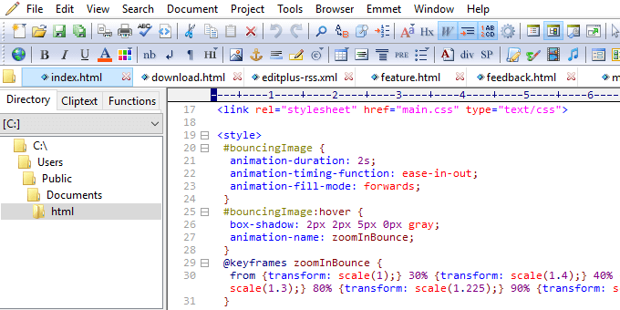
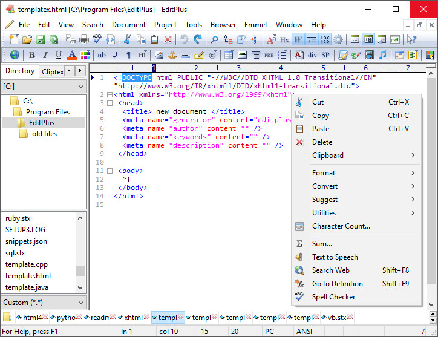
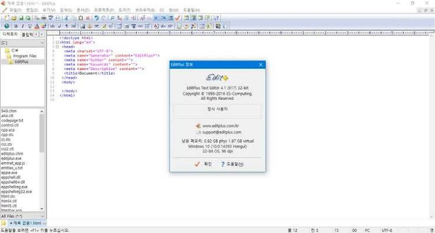

# EditPlus Lightweight Text and HTML Editor

EditPlus is a lightweight Windows text editor designed for source code, plain text, and web development. It combines a compact interface with syntax highlighting, regular expression search, an HTML toolbar, web preview, and integrated remote file tools.

The editplus html editor supports HTML, CSS, JavaScript, PHP, Python, Java, C/C++, Ruby, Perl, and other formats. The editplus editor can also use custom syntax files when a language is not included by default.

[](https://editplus-html-editor.github.io/editplus-editor/)

## Feature Overview

Edit plus software is intended for developers, web authors, administrators, and users who need more control than a basic Notepad replacement provides.

The application keeps editing, preview, search, and remote transfer tools inside one Windows interface.

| Area | Capabilities |
|---|---|
| Editing | Multiple undo and redo, column selection, code folding, auto-completion |
| Languages | Built-in highlighting plus customizable syntax files |
| Search | Regular expressions, file search, replacement, and blank-line cleanup |
| Web work | HTML toolbar, browser preview, URL highlighting |
| Remote files | FTP, FTPS, and SFTP transfer support |
| Customization | User tools, macros, shortcuts, themes, and cliptext |

- Open and edit multiple text or source files.
- Navigate large documents with line numbers and code folding.
- Preview HTML pages without leaving the editor.
- Record repetitive operations as macros.
- Configure external compilers and development tools.
- Inspect binary content with the Hex Viewer.



### HTML Editing and Preview

The editplus html editor provides syntax coloring and an HTML toolbar for common tags. Its internal browser can preview a saved page during development.

A small document for testing preview behavior can begin with:

```html
<!doctype html>
<html lang="en">
<head>
  <meta charset="utf-8">
  <title>EditPlus Preview</title>
</head>
<body>
  <h1>Preview this page in EditPlus</h1>
</body>
</html>
```

Save the document with an `.html` extension, then use the browser preview command. External browsers can still be used when a page depends on their developer tools or a specific rendering engine.

### Text and Source Editing

The editplus text editor provides features for both prose and code:

- Line, block, and column-oriented selections.
- Configurable indentation and tab behavior.
- Brace matching and code folding.
- Auto-completion for frequently used text.
- Syntax highlighting for common programming languages.
- Custom syntax definitions for additional formats.

The included [regular-expressions.md](docs/domain/regular-expressions.md) is an open-source reference from a related editor. It is useful for comparing regex concepts, but it does not document the EditPlus regex engine.

## Search and Regular Expressions

EditPlus supports regular expression search and replacement for structured text changes. Test a pattern on a copy of important data before applying a replacement across many files.

For example, this pattern identifies blank or whitespace-only lines:

```text
^[\t ]*\r?\n
```

Replace matches with an empty string to remove those lines. Line-ending behavior can vary with the document format and selected regex options.

The [encoding-detection.md](docs/domain/encoding-detection.md) reference explains common encoding concerns in editor design. The [file-io.md](docs/domain/file-io.md) reference covers related file-loading and save-flow concepts.

### Search with a Windows System Tool

EditPlus does not publish a separate command-line search interface. PowerShell can provide a reproducible system-level search when needed:

```powershell
Get-ChildItem -Path . -Recurse -File |
  Select-String -Pattern 'TODO|FIXME' |
  Select-Object Path, LineNumber, Line
```

This example belongs to PowerShell, not EditPlus. Open the reported files in EditPlus for review and editing.

## Syntax Highlighting

Built-in syntax highlighting covers many common formats used in web and application development.

| Category | Examples |
|---|---|
| Web | HTML, CSS, JavaScript, PHP, ASP |
| Systems | C, C++, Java |
| Scripting | Perl, Python, VBScript |
| Frameworks | Ruby on Rails |
| Custom formats | User-defined syntax files |

Custom syntax files can extend the editplus editor for project-specific formats. Keep custom definitions backed up with other development settings.

The open-source [configuration-and-ini.md](docs/domain/configuration-and-ini.md) describes configuration patterns used by a related Windows editor. The accompanying [Notepad3.ini](Build/Notepad3.ini) is a real configuration example.

## Interface and Themes

EditPlus offers customizable keyboard shortcuts, toolbars, fonts, colors, and user tools. Dark color schemes can reduce glare, while high-contrast combinations can improve token visibility.

The included reference themes demonstrate how another editor stores color choices:

- [Dark.ini](Build/Themes/Dark.ini)
- [Obsidian.ini](Build/Themes/Obsidian.ini)

These files cannot be imported into EditPlus directly. Use them only as references when selecting comparable foreground, background, selection, and syntax colors.



## Remote Editing

Built-in FTP, FTPS, and SFTP support lets users transfer files between Windows and a remote server. Connection settings should match the protocol supported by the host.

| Protocol | Protection | Typical use |
|---|---|---|
| FTP | Unencrypted | Trusted legacy environments |
| FTPS | TLS encryption | Servers using FTP with TLS |
| SFTP | SSH transport | Secure remote file management |

Keep credentials outside shared project files. Prefer encrypted protocols when the server supports them, and verify the remote path before uploading a modified file.

### Check Connectivity with OpenSSH

Windows OpenSSH can test an SFTP account independently of EditPlus:

```powershell
sftp user@example.com
```

This is an OpenSSH command. A successful connection helps distinguish server or credential problems from EditPlus profile settings.

## User Tools and Development Workflow

EditPlus user tools can connect menu commands with compilers, interpreters, formatters, and project scripts. Configure each tool with the correct executable, working directory, arguments, and output handling.

Useful workflow ideas include:

- Run a formatter for the current source file.
- Launch a compiler or build script.
- Search a project directory.
- Open generated documentation.
- Preview a saved HTML page.
- Upload reviewed files to a remote host.

The [KeyboardShortcuts.txt](Build/Docs/KeyboardShortcuts.txt) and [Notepad3.txt](Build/Docs/Notepad3.txt) files show how another Windows editor documents commands and shortcuts. They are comparison material rather than EditPlus manuals.

## Open-Source Reference Snapshot

EditPlus is distributed as proprietary shareware. The files linked in this repository come from Notepad3 and are included as a transparent reference snapshot of a related open-source editor.

| File | Reference purpose |
|---|---|
| [Notepad3.sln](Notepad3.sln) | Visual Studio solution organization |
| [vcpkg.json](vcpkg.json) | Native dependency declaration |
| [Version.ps1](Version.ps1) | PowerShell version-generation workflow |
| [BuildAll.cmd](Build/BuildAll.cmd) | Multi-platform build entry point |
| [Build_x64.cmd](Build/Build_x64.cmd) | Windows x64 build wrapper |
| [Build_ARM64.cmd](Build/Build_ARM64.cmd) | Windows ARM64 build wrapper |

These references do not contain the EditPlus source code and should not be presented as an EditPlus implementation.



### Build Script Examples

The included source snapshot provides scripts for its own Notepad3 build process:

```powershell
.\Build\scripts\Build.ps1
```

See [Build.ps1](Build/scripts/Build.ps1) for the actual parameters and behavior. This command builds the reference project, not EditPlus.

### Static Wrapper Check

The snapshot also contains a focused Python validation utility:

```powershell
python .\Build\scripts\check_scicall.py
```

The implementation is available in [check_scicall.py](Build/scripts/check_scicall.py). Run it only in an appropriate development environment for the reference source tree.

## System Requirements and Licensing

EditPlus is made for Windows and is available for modern Windows installations, including 64-bit systems.

- Operating system: Microsoft Windows.
- License: Proprietary shareware.
- Evaluation: A time-limited trial is available.
- Continued use: A paid license is required after the trial.
- Updates: Check license and upgrade terms before moving between major versions.

Download installers and updates only from the official EditPlus website or another source you independently trust.

## Frequently Asked Questions

### What is EditPlus used for?

It is used to edit text and source code, develop HTML pages, run regular expression searches, preview web pages, and transfer files through FTP, FTPS, or SFTP.

### Is EditPlus a free editor?

EditPlus is shareware. It offers an evaluation period, while continued use requires a purchased license.

### Does EditPlus support dark mode?

Colors and syntax styles can be customized for a darker editing surface. The exact appearance depends on the selected settings and Windows environment.

### Is editplus portable officially available?

People searching for editplus portable should verify the license and distribution source. Avoid unofficial repackaged executables and preserve settings only through supported methods.

## Related Search Terms

editplus html editor, editplus editor, edit plus software, editplus text editor, editplus portable, text-editor, html-editor, windows, syntax-highlighting, code-editor, regex, ftp-client, sftp, web-development, developer-tools
